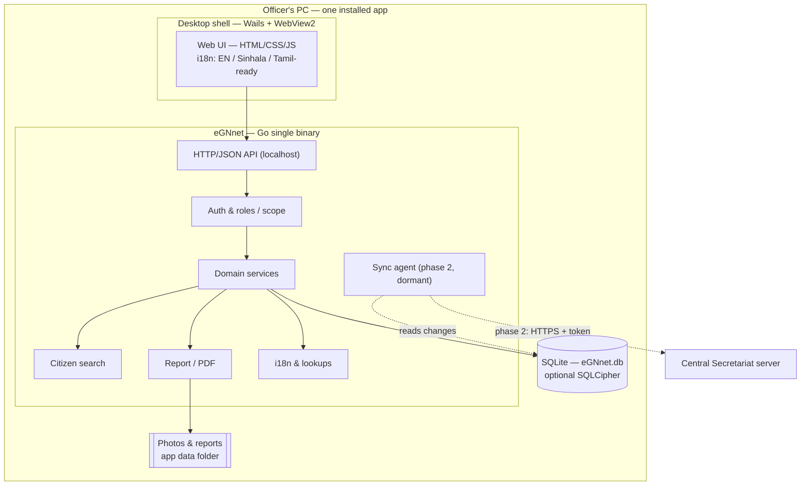
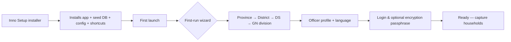
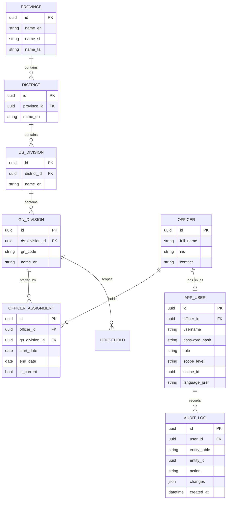
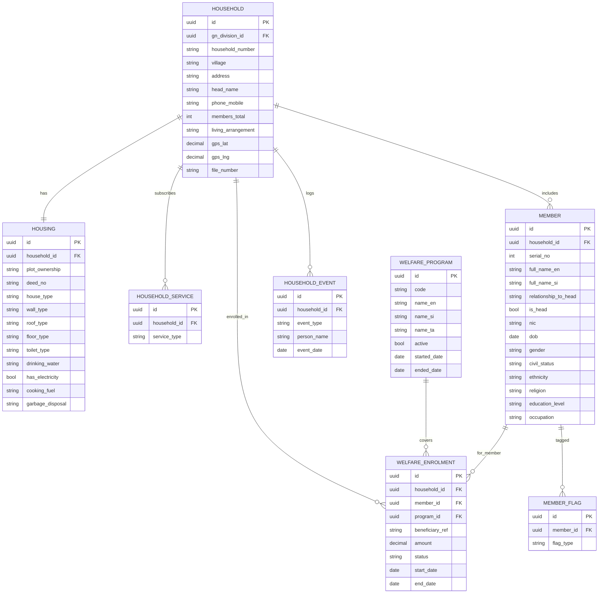
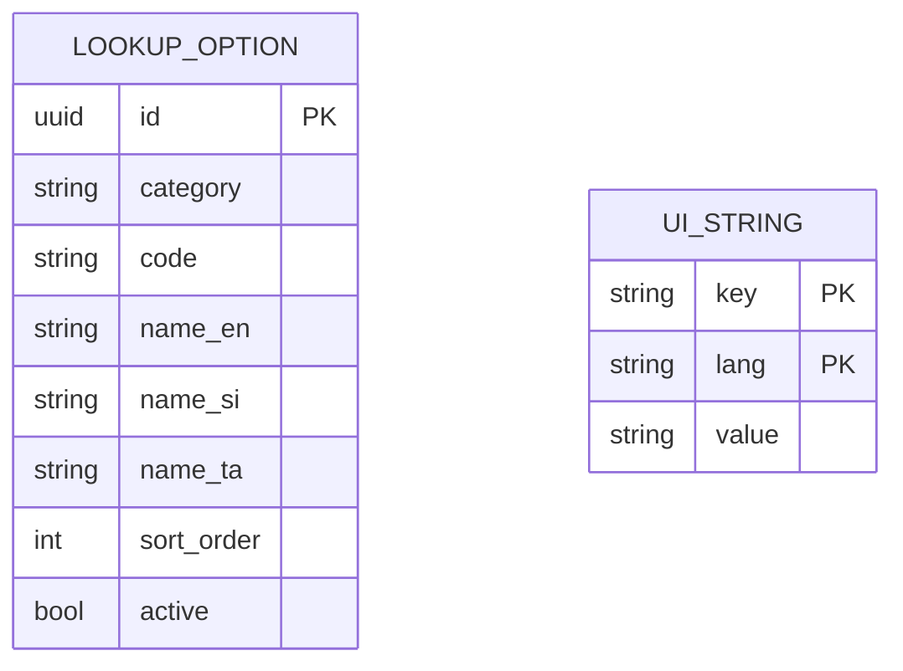
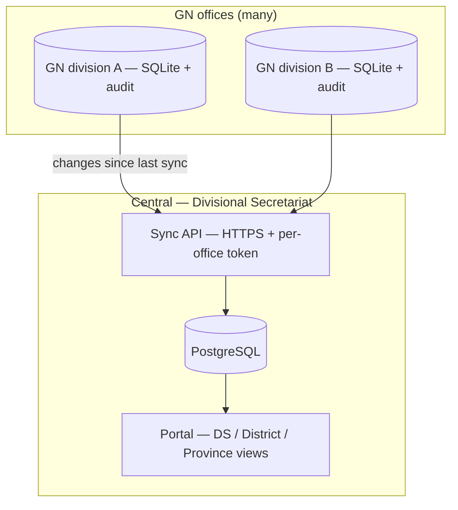
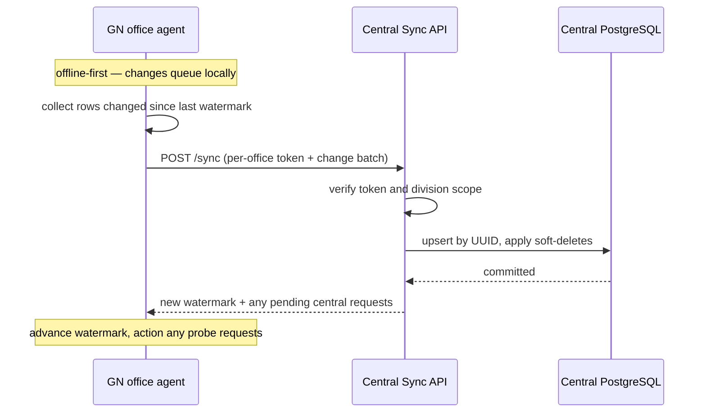

# eGNnet — Database schema & application architecture

_Grama Niladhari household records system. Design reference._
_Mermaid blocks below render on GitHub._

---

## 1. Overview

One form = one household. The app digitises the official GN Division household data form, section by section, and works for **any** GN division in Sri Lanka (officer picks their division at setup).

- **Stack:** Go (single self-contained binary, embedded HTTP server) · SQLite (embedded, pure-Go driver) · Wails + WebView2 (native desktop window) · Inno Setup installer.
- **UI:** English + Sinhala now, Tamil-ready (coded option lists carry all three labels).
- **Scope:** nationwide, per-division; offline-first; sync-ready for a future central tier.

**Principles**
- Mirror the paper form (incl. income, agriculture, livestock, welfare categories the old app lacked).
- Coded option lists in one lookup table with EN/Si/Ta labels — adding Tamil = filling a column.
- UUID keys + timestamps + soft-delete + audit log → safe future roll-up to a central server.
- No DB server, no JRE, no lost-password problem; optional at-rest encryption (SQLCipher / BitLocker).

---

## 2. Application architecture

**Packaging & first run**

Seed DB ships with the national admin hierarchy and every form option list. On Windows the only platform requirement is WebView2 (standard on Win 10/11; bundled by the installer if missing). The same pure-Go binary also runs on Linux (Ubuntu).

---

## 3. Data model

**Standard columns on every transactional table:** `id` (UUID PK), `created_at`, `updated_at`, `deleted_at` (soft delete), and `surveyed_by` where field-captured. Reference tables use stable codes.

### A · Administration & access

Officer ↔ division is a **many-to-many dated assignment**, so an officer can hold several current assignments at once (1–3 divisions), a transfer is one new row, and posting history is kept. On login the officer sees only their current divisions and switches between them with a picker; each household stays scoped to its own division.

### B · Household, housing & members

Welfare categories (pregnant, lactating, disabled, chronically ill, elderly, abroad) = member flags; births/deaths = household events. **Welfare schemes are configurable:** `welfare_program` holds the list (Aswesuma, elderly/disability allowances, …) and is renameable (audit log keeps the history); `welfare_enrolment` links a household — optionally a specific member — to a program, so one household can hold several and different households have different ones.

### C · Land, assets & economy

```mermaid
erDiagram
  HOUSEHOLD ||--o{ LAND_HOLDING : owns
  HOUSEHOLD ||--o{ LAND_CROP : grows
  HOUSEHOLD ||--o{ PADDY_CULTIVATION : cultivates
  HOUSEHOLD ||--o{ LIVESTOCK : keeps
  HOUSEHOLD ||--o{ POULTRY : keeps
  HOUSEHOLD ||--o{ APPLIANCE : owns
  HOUSEHOLD ||--o{ VEHICLE : owns
  HOUSEHOLD ||--o{ EQUIPMENT : owns
  HOUSEHOLD ||--o{ PERMIT : holds
  HOUSEHOLD ||--o{ LOAN : holds
  HOUSEHOLD ||--o{ STATE_AID : received
  HOUSEHOLD ||--|| HOUSEHOLD_FINANCE : summary
  HOUSEHOLD ||--o{ INCOME_SOURCE : earns_from
  HOUSEHOLD ||--o{ MONTHLY_EXPENSE : spends
  LAND_HOLDING { uuid id PK
    uuid household_id FK
    string land_class
    string tenure_type
    int acres
    int roods
    int perches }
  LAND_CROP { uuid id PK
    uuid household_id FK
    string crop_type
    string extent_or_trees
    bool is_main }
  PADDY_CULTIVATION { uuid id PK
    uuid household_id FK
    string season
    string extent }
  LIVESTOCK { uuid id PK
    uuid household_id FK
    string animal_type
    int count }
  POULTRY { uuid id PK
    uuid household_id FK
    string poultry_type
    int count }
  APPLIANCE { uuid id PK
    uuid household_id FK
    string appliance_type
    int count }
  VEHICLE { uuid id PK
    uuid household_id FK
    string vehicle_type
    string registration_no
    bool income_use }
  EQUIPMENT { uuid id PK
    uuid household_id FK
    string equipment_type
    bool income_use }
  PERMIT { uuid id PK
    uuid household_id FK
    string permit_type
    string permit_no
    date valid_until }
  LOAN { uuid id PK
    uuid household_id FK
    bool is_microfinance
    string provider }
  STATE_AID { uuid id PK
    uuid household_id FK
    string project
    int year
    string progress }
  HOUSEHOLD_FINANCE { uuid id PK
    uuid household_id FK
    string monthly_income_bracket }
  INCOME_SOURCE { uuid id PK
    uuid household_id FK
    string source_type }
  MONTHLY_EXPENSE { uuid id PK
    uuid household_id FK
    string category
    decimal amount }
```

### D · Lookups & localisation

One generic lookup table powers every dropdown with trilingual labels; `UI_STRING` holds interface text. `category` examples: `house_type`, `wall_type`, `roof_type`, `floor_type`, `toilet_type`, `education_level`, `income_bracket`, `crop_type`, `vehicle_type`, `appliance_type`, `member_flag`, `relationship`, `religion`, `ethnicity`.

---

## 4. Key design decisions

| Area | Decision | Why |
|---|---|---|
| Keys | UUID primary keys | No collisions across PCs when rolled up; fixes old app's duplicate-key crashes |
| History | Soft delete + audit log | Basis for safe incremental sync and accountability |
| Localisation | Store codes, not labels | Switch language / add Tamil without touching data |
| Multi-division | Many-to-many dated officer assignments | One officer can serve several divisions at once (1–3); transfer = one insert; history preserved |
| Search | Indexed multi-criteria + SQLite FTS | Richer citizen search the old app lacked |
| Security | Local, optionally encrypted; hashed passwords | No network surface by default |

---

## 5. Future: central tier

Every row has a UUID, timestamp and audit trail, so sync is an incremental push of changes. The central server, inter-tier auth and reconciliation rules are a deliberate **phase 2** on the same model and backend — the local app needs none of it to work today.

### Sync flow

- **Push (sync up):** the agent keeps a per-office **watermark** and sends only rows changed since it (from the audit log / `updated_at`). Central **upserts by UUID**, so it's idempotent — a dropped connection or partial sync just resumes from the same watermark. Offline-first: changes queue locally and go up on "Sync now" or a schedule.
- **Pull (probe):** officer PCs sit behind home routers with no fixed address, so the centre can't reach into them. It queries its **synced mirror** instead; a specific request waits for the agent to collect on its next check-in, keeping the mirror near-live. (Only offices on a reachable server could expose a direct read-only API — the exception.)
- **Ownership:** each office is the sole authority for its own divisions' data, so centrally it's a read/rollup model and write conflicts are rare by design.
- **Security:** TLS throughout; a per-office credential authorising only that office's divisions; hashed local logins; optionally signed payloads.

---

## 6. Table summary (~34)

- **Admin:** province, district, ds_division, gn_division, officer, officer_assignment, app_user, audit_log
- **Household & people:** household, housing, household_service, member, member_flag, household_event, welfare_program, welfare_enrolment
- **Land & agriculture:** land_holding, land_crop, paddy_cultivation
- **Assets:** livestock, poultry, appliance, vehicle, equipment, permit
- **Economy:** household_finance, income_source, monthly_expense, loan, state_aid
- **Localisation:** lookup_option, ui_string

> The authoritative schema is the SQL migration that ships with the build (`internal/db/schema.sql`); the column lists above are representative. Fuller investigation notes (old-app findings, paper-form gap analysis) are kept in the project workspace.
